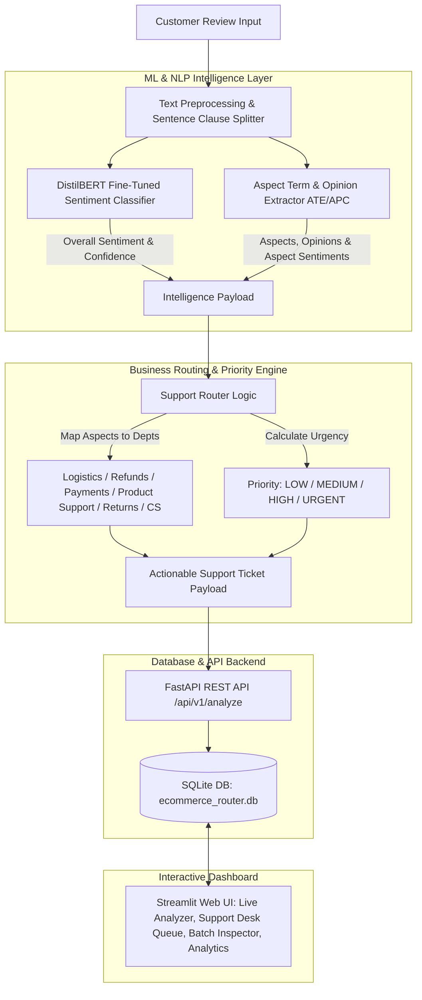
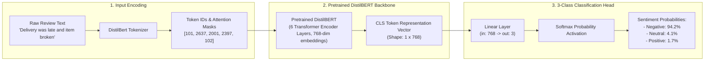

# ⚡ Intelligent E-Commerce Review Analyzer & Support Router

An end-to-end NLP intelligence platform and automated customer support ticket router that ingests customer review text, performs sentiment classification using fine-tuned **DistilBERT**, extracts fine-grained aspect opinions (ABSA), calculates ticket priority, and dispatches tickets to target support departments via FastAPI, SQLAlchemy, and Streamlit.

---

## 🏗️ End-to-End Architecture & Flow



---

## 🧠 DistilBERT Fine-Tuning & Classification Head Architecture



---

## 📌 Business Routing & Priority Matrix

| Business Aspect | Primary Target Department | Example Keywords | Default Priority |
| :--- | :--- | :--- | :--- |
| `delivery` | **Logistics** | delivery, shipping, courier, delayed, late, tracking | `MEDIUM` |
| `product_quality` | **Product Support** | quality, broken, screen, defective, material, build | `MEDIUM` |
| `payment` | **Payments** | payment, charged twice, fee, gateway, transaction | `HIGH` / `URGENT` |
| `refund_return` | **Refunds** | refund, return, money back, pickup, reimbursement | `HIGH` / `URGENT` |
| `packaging` | **Returns / Replacement** | packaging, box, envelope, bubble wrap, torn | `LOW` |
| `customer_support` | **Customer Support** | support, representative, agent, email, response | `MEDIUM` |

*Note: Reviews with multiple negative critical issues (e.g. Payment failed + Refund pending) are automatically escalated to **`URGENT`**.*

---

## 📂 Repository Structure

```
ecommerce-review-router/
│
├── main.py                         # FastAPI app, CORS, / and /health
├── app/
│   ├── api/
│   │   └── routes.py               # REST API Endpoints (/analyze, /tickets, /analytics)
│   ├── services/
│   │   ├── preprocessing.py        # Text cleaning & sentence clause segmentation
│   │   ├── sentiment.py            # SentimentAnalyzer (Transformer + Baseline fallback)
│   │   ├── aspect_extraction.py    # AspectExtractor (ATE & APC engine)
│   │   ├── routing.py              # SupportRouter business logic engine
│   │   └── ticket_service.py       # Ticket generator service
│   ├── models/
│   │   └── trained_model/          # Exported trained weights & tokenizer
│   └── db/
│       ├── database.py             # SQLAlchemy engine & session setup
│       └── models.py               # Database ORM schema (ReviewAnalysis, SupportTicket)
│
├── data/
│   └── build_dataset.py            # Dataset generator (run this first; CSVs are gitignored)
│
├── notebooks/
│   ├── 01_eda.ipynb                # Exploratory Data Analysis & visual plots
│   ├── 02_sentiment_baseline.ipynb # TF-IDF + Logistic Regression Baseline
│   ├── 03_transformer_sentiment.ipynb # DistilBERT Transformer fine-tuning
│   └── 04_aspect_extraction.ipynb  # Aspect Term & Polarity Classification
│
├── tests/                          # Pytest suite (48 unit, regression & integration tests)
├── .github/workflows/ci.yml        # Tests + image builds on every PR
├── train_transformer.py            # Fine-tuning CLI script for DistilBERT
├── streamlit_app.py                # Interactive Streamlit Web UI Dashboard
├── pyproject.toml                  # Project metadata & dependencies
└── README.md
```

---

## 📊 Measured Results

Held-out split of 300 reviews (`test_size=0.2, random_state=42`, stratified).
Reproduce with `.venv/Scripts/python.exe paper/evaluate_pipeline.py`.

| Stage | Metric | Value |
| :--- | :--- | :--- |
| Sentiment (DistilBERT) | accuracy / weighted F1 | 0.9633 / 0.9641 |
| Sentiment (TF-IDF baseline) | accuracy / weighted F1 | 0.9600 / 0.9606 |
| Aspect extraction | micro P / R / F1 | 0.8971 / 0.7863 / 0.8380 |
| Department routing | accuracy | 0.7733 |
| Priority | accuracy | 0.9000 |
| Priority | under-escalation rate | 0.0067 |
| End-to-end | mean / p95 latency | 42.9 ms / 73.3 ms |

**Note on the corpus.** The dataset is generated from templates, and 31.7% of
held-out reviews appear verbatim in train. Scores on it are therefore an upper
bound and should not be read as performance on organic reviews.

---

## 🧠 Model Artifacts

Trained weights are **not** committed (see `.gitignore`). Build them locally:

```powershell
uv run python data/build_dataset.py
uv run python train_transformer.py
```

Until then the service runs the committed TF-IDF baseline and says so. Check
which model is live at any time:

```powershell
curl http://127.0.0.1:8000/health
```

`degraded: true` means the transformer is not loaded. Set `STRICT_MODEL=1` to
make a missing-weights start fail instead of serving the baseline.

---

## 🏃 Quick Start Guide

### 1. Generate Dataset & Train Transformer Model
```powershell
# Generate dataset
uv run python data/build_dataset.py

# Fine-tune DistilBERT Transformer
uv run python train_transformer.py
```

### 2. Launch FastAPI Backend
```powershell
uv run uvicorn main:app --reload --port 8000
```
- Interactive Swagger API Docs: [http://127.0.0.1:8000/docs](http://127.0.0.1:8000/docs)

### 3. Launch Streamlit Web UI
```powershell
uv run streamlit run streamlit_app.py
```

### 4. Run Automated Test Suite
```powershell
uv run pytest tests/
```

---

## 🐳 Docker Deployment

Run both the FastAPI Backend & Streamlit Frontend together using Docker Compose:

```powershell
# Build and launch all services in detached mode
docker-compose up --build -d

# View container logs
docker-compose logs -f

# Stop container services
docker-compose down
```

- **FastAPI Backend**: `http://localhost:8000/docs`
- **Streamlit Web UI**: `http://localhost:8501`

