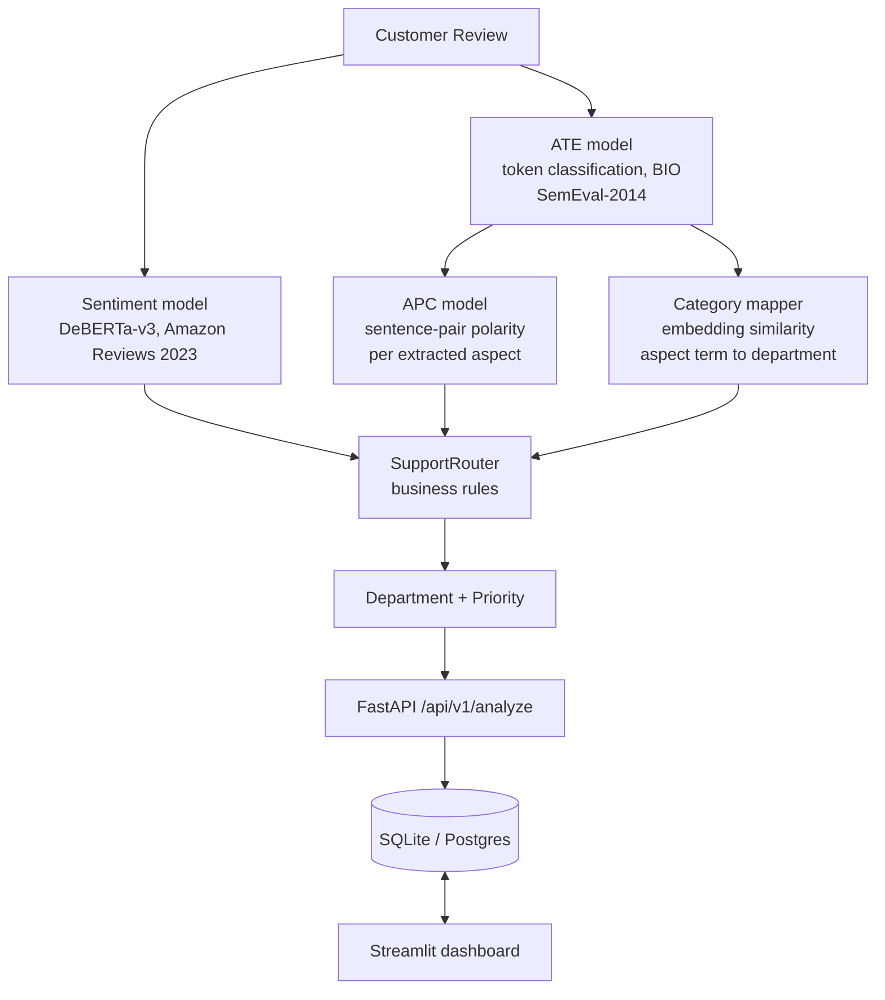

# ⚡ Intelligent E-Commerce Review Analyzer & Support Router

An aspect-based sentiment analysis pipeline that reads a customer review, extracts the specific things it complains about, decides how the customer feels about each one, and routes a prioritised ticket to the right support department.

Three trained transformer models do the work: aspect term extraction and aspect polarity (both on **SemEval-2014 Task 4**, the standard ABSA benchmark) plus review-level sentiment (on **Amazon Reviews 2023**). Served through FastAPI + SQLAlchemy with a Streamlit dashboard.

---

## 🏗️ Pipeline



Three trained models, not a keyword lexicon:

| Stage | Model | Trained on |
| :--- | :--- | :--- |
| Aspect term extraction | DeBERTa-v3-base, token classification | SemEval-2014 Task 4 |
| Aspect polarity | DeBERTa-v3-base, sentence-pair | SemEval-2014 Task 4 |
| Review sentiment | DeBERTa-v3-base | Amazon Reviews 2023 |
| Term to department | all-MiniLM-L6-v2 similarity | no training; prototype phrases |

Polarity is conditioned on the aspect, so "the phone is great but delivery was
late" resolves per aspect without clause-splitting heuristics. The keyword
lexicon remains only as a fallback when model artifacts are absent.

---

## ⚡ Requirements

**Models run on GPU.** Training, evaluation and inference assert CUDA and fail
with an actionable message if it is missing — there is no silent CPU execution.
The only exception is `pytest`, which sets `ALLOW_CPU=1` so CI can run on
GPU-less runners.

Install torch from the CUDA index (already configured in `pyproject.toml`):

```powershell
uv sync --group dev
python -c "import torch; print(torch.__version__, torch.cuda.is_available())"
```

---

## 📌 Business Routing & Priority Matrix

| Business Aspect | Primary Target Department | Example Keywords | Default Priority |
| :--- | :--- | :--- | :--- |
| `delivery` | **Logistics** | delivery, shipping, courier, delayed, late, tracking | `MEDIUM` |
| `product_quality` | **Product Support** | quality, broken, screen, defective, material, build | `MEDIUM` |
| `payment` | **Payments** | payment, charged twice, fee, gateway, transaction | `HIGH` / `URGENT` |
| `refund_return` | **Refunds** | refund, return, money back, pickup, reimbursement | `HIGH` / `URGENT` |
| `packaging` | **Returns / Replacement** | packaging, box, envelope, bubble wrap, torn | `LOW` |
| `customer_support` | **Customer Support** | support, representative, agent, email, response | `MEDIUM` |

*Note: Reviews with multiple negative critical issues (e.g. Payment failed + Refund pending) are automatically escalated to **`URGENT`**.*

---

## 📂 Repository Structure

```
ecommerce-review-router/
│
├── app/
│   ├── main.py                     # FastAPI Application lifecycle & CORS setup
│   ├── api/
│   │   └── routes.py               # REST API Endpoints (/analyze, /tickets, /analytics)
│   ├── services/
│   │   ├── preprocessing.py        # Text cleaning & sentence clause segmentation
│   │   ├── sentiment.py            # SentimentAnalyzer (Transformer + Baseline fallback)
│   │   ├── aspect_extraction.py    # AspectExtractor (ATE & APC engine)
│   │   ├── routing.py              # SupportRouter business logic engine
│   │   └── ticket_service.py       # Ticket generator service
│   ├── models/
│   │   └── trained_model/          # Exported trained weights & tokenizer
│   └── db/
│       ├── database.py             # SQLAlchemy engine & session setup
│       └── models.py               # Database ORM schema (ReviewAnalysis, SupportTicket)
│
├── data/
│   ├── build_dataset.py            # Dataset generator script
│   ├── raw/                        # Raw CSV reviews
│   └── processed/                  # Processed 1,500 e-commerce review dataset
│
├── notebooks/
│   ├── 01_eda.ipynb                # Exploratory Data Analysis & visual plots
│   ├── 02_sentiment_baseline.ipynb # TF-IDF + Logistic Regression Baseline
│   ├── 03_transformer_sentiment.ipynb # DistilBERT Transformer fine-tuning
│   └── 04_aspect_extraction.ipynb  # Aspect Term & Polarity Classification
│
├── tests/                          # Automated Pytest suite (11 unit & integration tests)
├── train_transformer.py            # Fine-tuning CLI script for DistilBERT
├── streamlit_app.py                # Interactive Streamlit Web UI Dashboard
├── pyproject.toml                  # Project metadata & dependencies
└── README.md
```

---

## 🏃 Quick Start

### 1. Get the models

Training happens once on a GPU machine; everything else downloads.

```powershell
# Already trained and published:
python scripts/download_models.py --user <your-hf-username>

# Or train them (see Training below)
```

### 2. Run the backend

```powershell
uv run uvicorn main:app --reload --port 8000
```

- Swagger: http://127.0.0.1:8000/docs
- Health:  http://127.0.0.1:8000/health — reports which models are live, on
  which device, and sets `degraded: true` if any are missing.

### 3. Run the dashboard

```powershell
uv run streamlit run streamlit_app.py
```

### 4. Tests

```powershell
uv run pytest tests/
```

---

## 🎓 Training

Run the smoke profile first. It takes about two minutes and proves the whole
pipeline executes before any real GPU time is spent.

```powershell
python data/fetch_real_datasets.py --profile smoke
python train_all.py --profile smoke
```

Then the real run — one command, three models, published to the Hub:

```powershell
python data/fetch_real_datasets.py --profile 4090
python train_all.py --profile 4090 --push-to-user <your-hf-username>
```

Profiles: `4090`, `t4`, `3050`, `smoke`. For Colab (T4), open
[`notebooks/train_on_colab.ipynb`](notebooks/train_on_colab.ipynb) — it calls
the same code, so results match.

Evaluate on real held-out data:

```powershell
python eval/evaluate_real.py
```

---

## 📊 On the numbers

The previous pipeline reported **0.9633 accuracy**. That figure was measured on
a corpus generated from ~100 template phrases where **31.7% of the test split
appeared verbatim in training** — it measured memorisation.

Evaluated on real Amazon reviews, that same model scores **0.60**.

Real-data scores will therefore look lower than the old ones and are worth more:
SemEval-2014 is a published benchmark, so aspect extraction and polarity numbers
are comparable to the literature, and `data/fetch_real_datasets.py` asserts zero
train/test overlap as a hard failure rather than reporting it after the fact.

---

## 🐳 Docker Deployment

Run both the FastAPI Backend & Streamlit Frontend together using Docker Compose:

```powershell
# Build and launch all services in detached mode
docker-compose up --build -d

# View container logs
docker-compose logs -f

# Stop container services
docker-compose down
```

- **FastAPI Backend**: `http://localhost:8000/docs`
- **Streamlit Web UI**: `http://localhost:8501`

