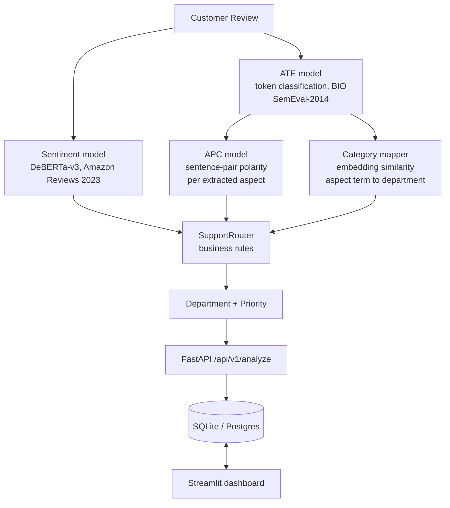

# ⚡ Intelligent E-Commerce Review Analyzer & Support Router

An aspect-based sentiment analysis pipeline that reads a customer review, extracts the specific things it complains about, decides how the customer feels about each one, and routes a prioritised ticket to the right support department.

Three trained transformer models do the work: aspect term extraction and aspect polarity (both on **SemEval-2014 Task 4**, the standard ABSA benchmark) plus review-level sentiment (on **Amazon Reviews 2023**). Served through FastAPI + SQLAlchemy with a Streamlit dashboard.

---

## 🏗️ Pipeline



Three trained models, not a keyword lexicon:

| Stage | Model | Trained on |
| :--- | :--- | :--- |
| Aspect term extraction | DeBERTa-v3-base, token classification | SemEval-2014 Task 4 |
| Aspect polarity | DeBERTa-v3-base, sentence-pair | SemEval-2014 Task 4 |
| Review sentiment | DeBERTa-v3-base | Amazon Reviews 2023 |
| Term to department | all-MiniLM-L6-v2 similarity | no training; prototype phrases |

Polarity is conditioned on the aspect, so "the phone is great but delivery was
late" resolves per aspect without clause-splitting heuristics. The keyword
lexicon remains only as a fallback when model artifacts are absent.

---

## ⚡ Requirements

**Models run on GPU.** Training, evaluation and inference assert CUDA and fail
with an actionable message if it is missing — there is no silent CPU execution.
The only exception is `pytest`, which sets `ALLOW_CPU=1` so CI can run on
GPU-less runners.

Install everything, including the CUDA build of torch (the index is already
configured in `pyproject.toml`), then confirm the GPU is visible:

```powershell
uv sync --group dev
uv run python -c "import torch; print(torch.__version__, torch.cuda.is_available())"
# expect: 2.14.0+cu130 True
```

Run every script with **`uv run python ...`**. A bare `python` usually resolves
to the system interpreter, which has none of the project's dependencies.

---

## 📌 Business Routing & Priority Matrix

| Business Aspect | Primary Target Department | Fallback Keywords | Default Priority |
| :--- | :--- | :--- | :--- |
| `delivery` | **Logistics** | delivery, shipping, courier, delayed, late, tracking | `MEDIUM` |
| `product_quality` | **Product Support** | quality, broken, screen, defective, material, build | `MEDIUM` |
| `payment` | **Payments** | payment, charged twice, fee, gateway, transaction | `HIGH` / `URGENT` |
| `refund_return` | **Refunds** | refund, return, money back, pickup, reimbursement | `HIGH` / `URGENT` |
| `packaging` | **Returns / Replacement** | packaging, box, envelope, bubble wrap, torn | `LOW` |
| `customer_support` | **Customer Support** | support, representative, agent, email, response | `MEDIUM` |

*Reviews with multiple negative critical issues (e.g. payment failed + refund pending) escalate to **`URGENT`**.
Departments are assigned by the embedding-based mapper (`app/services/aspect_mapping.py`); the keywords above are
used only by the fallback lexicon when the trained models are absent.*

---

## 📂 Repository Structure

```
intelligent-review-router/
│
├── main.py                          # FastAPI app, CORS, / and /health
├── streamlit_app.py                 # Dashboard: analyzer, batch, ticket desk, analytics
│
├── app/
│   ├── api/routes.py                # /analyze, /tickets, /analytics
│   ├── db/                          # SQLAlchemy engine and ORM models
│   ├── services/
│   │   ├── absa.py                  # Trained ABSA pipeline (ATE -> APC -> mapper)
│   │   ├── aspect_mapping.py        # Aspect term -> department (embedding similarity)
│   │   ├── bio_alignment.py         # Aspect span recovery and BIO tagging
│   │   ├── sentiment.py             # Review sentiment (transformer, TF-IDF fallback)
│   │   ├── aspect_extraction.py     # Keyword lexicon (fallback only)
│   │   ├── routing.py               # Department and priority rules
│   │   ├── ticket_service.py        # Runs the pipeline for one review
│   │   ├── artifacts.py             # Where trained models live
│   │   └── device.py                # GPU requirement and the pytest CPU escape
│   └── models/trained_model/
│       ├── baseline/                # TF-IDF fallback (committed)
│       └── sentiment/               # Legacy DistilBERT metadata (weights not committed)
│
├── data/
│   ├── fetch_real_datasets.py       # Builds data/real/ from SemEval-2014 + Amazon Reviews
│   └── build_dataset.py             # Legacy synthetic generator (not used for training)
│
├── train_all.py                     # One command: trains, evaluates and publishes all 3 models
├── train_ate.py                     # Aspect term extraction
├── train_apc.py                     # Aspect polarity
├── train_sentiment.py               # Review sentiment
├── train_common.py                  # Shared config, GPU profiles, checkpoint/resume
│
├── eval/evaluate_real.py            # Per-stage evaluation on real held-out data
├── scripts/download_models.py       # Fetch trained models from the Hugging Face Hub
├── notebooks/
│   ├── train_on_colab.ipynb         # Colab (T4) wrapper around train_all.py
│   └── 01-04_*.ipynb                # Earlier synthetic-data experiments (historical)
│
├── tests/                           # 97 pytest tests (API, pipeline, training config, dashboard)
├── ci/                              # GitHub Actions workflow (see ci/README.md to enable)
└── Dockerfile, Dockerfile.streamlit, docker-compose.yml
```

Generated at runtime and git-ignored: `data/real/` (corpus), `models/` (trained
models; smoke runs go to `models/_smoke/`), `checkpoints/`.

---

## 🏃 Quick Start

### 1. Get the models

Training happens once on a GPU machine; everything else downloads.

```powershell
# Already trained and published:
uv run python scripts/download_models.py --user <your-hf-username>

# Or train them (see Training below)
```

### 2. Run the backend

```powershell
uv run uvicorn main:app --reload --port 8000
```

- Swagger: http://127.0.0.1:8000/docs
- Health:  http://127.0.0.1:8000/health — reports which models are live, on
  which device, and sets `degraded: true` if any are missing.

### 3. Run the dashboard

```powershell
uv run streamlit run streamlit_app.py
```

### 4. Tests

```powershell
uv run pytest tests/
```

---

## 🎓 Training

Run the smoke profile first. It takes about two minutes and proves the whole
pipeline executes before real GPU time is spent. Smoke models are written to
`models/_smoke/` and are **never served**, so this step cannot replace a real
model.

```powershell
uv run python data/fetch_real_datasets.py --profile smoke
uv run python train_all.py --profile smoke
```

Then the real run — one command, three models, published to the Hub:

```powershell
uv run hf auth login           # once; paste a token with write access
uv run python data/fetch_real_datasets.py --profile 4090
uv run python train_all.py --profile 4090 --push-to-user <your-hf-username>
```

| Profile | Hardware | Approximate time |
| :--- | :--- | :--- |
| `smoke` | any CUDA GPU | ~2 min |
| `4090` | RTX 4090, 24 GB | ~1.5–2 h (building the corpus adds ~6–10 min) |
| `t4` | Colab T4, 16 GB | ~3 h |
| `3050` | 6 GB laptop GPU | development only |

Almost all of that time is review sentiment: 5 epochs over ~320k reviews on the
`4090` profile. Peak memory measured at about 12 GB of 24.

**If a run is interrupted, run the same command again** — it resumes from the
last checkpoint. Checkpoints are tied to the exact configuration, so a smoke run
can never be resumed into a real one. Use `--no-resume` to start over. On Colab,
set `CHECKPOINT_DIR` to a Google Drive folder so a disconnect doesn't lose them.

For Colab, open [`notebooks/train_on_colab.ipynb`](notebooks/train_on_colab.ipynb);
it calls the same code, so results match.

After training, `/health` should report `degraded: false`, and the dashboard
sidebar lists the models in use. Evaluate on real held-out data:

```powershell
uv run python eval/evaluate_real.py
```

---

## 📊 On the numbers

The previous pipeline reported **0.9633 accuracy**. That figure was measured on
a corpus generated from ~100 template phrases where **31.7% of the test split
appeared verbatim in training** — it measured memorisation.

Evaluated on real Amazon reviews, that same model scores **0.60**.

Real-data scores will therefore look lower than the old ones and are worth more:
SemEval-2014 is a published benchmark, so aspect extraction and polarity numbers
are comparable to the literature, and `data/fetch_real_datasets.py` asserts zero
train/test overlap as a hard failure rather than reporting it after the fact.

---

## 🐳 Docker Deployment

Runs the API and dashboard together. Because models run on GPU, the host needs
an NVIDIA GPU and the [NVIDIA Container Toolkit](https://docs.nvidia.com/datacenter/cloud-native/container-toolkit/latest/install-guide.html)
(Docker Desktop on Windows provides GPU support through WSL 2).

Train or download the models on the host first — `./models` is mounted into
both containers and is not baked into the images:

```powershell
uv run python scripts/download_models.py --user <your-hf-username>

docker-compose up --build -d    # build and start
docker-compose logs -f          # follow logs
docker-compose down             # stop
```

- **FastAPI Backend**: `http://localhost:8000/docs` (check `/health`)
- **Streamlit Web UI**: `http://localhost:8501`
